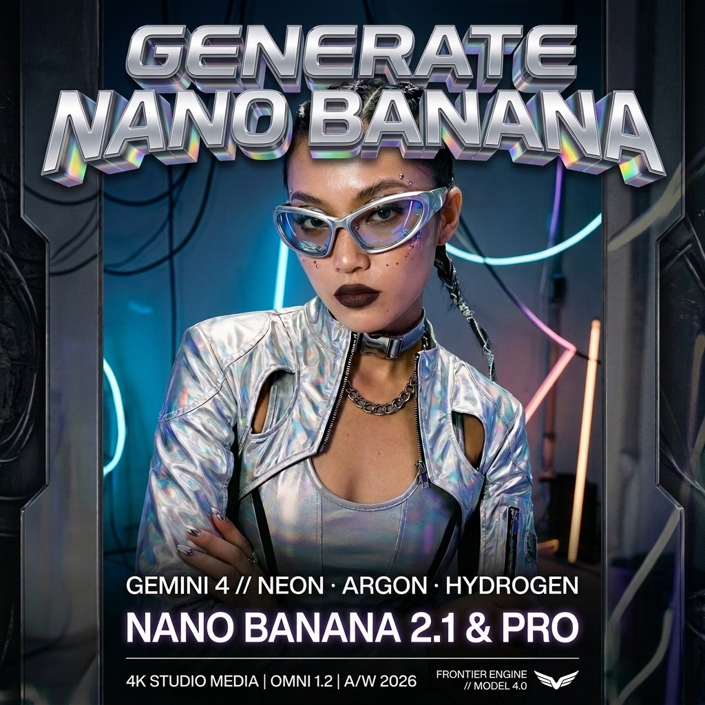

# nanobanana-skill — Nano Banana Image & Video Skill (Nano Banana Pro, 2.1 & Gemini 4) for Claude Code, Cursor & Antigravity

*Read this in other languages: [English](README.md), [Español](README.es.md).*

[](LICENSE)
[](https://github.com/AntonioCardenas/generate-nanobanana/stargazers)
[](https://github.com/AntonioCardenas/generate-nanobanana/commits/main)
[](https://github.com/vercel-labs/skills)
[](https://github.com/sickn33/agentic-awesome-skills)

> **Open-source Nano Banana skill (`/generate`) for AI image generation, video generation, and visual reasoning**, powered by Google's **Gemini Interactions API**: **Nano Banana 2 Lite** (`gemini-3.1-flash-lite-image`), **Nano Banana 2.1** (`gemini-nano-banana-2.1`), **Nano Banana Pro** (`gemini-3-pro-image`), **Gemini Omni 1.2 Flash** (`gemini-omni-1.2-flash`), and **Gemini 4** (`Carbon`, `Argon`, `Neon`, `Hydrogen`). Works natively in **Claude Code**, **Cursor**, **Antigravity**, **Antigravity CLI**, **Codex**, and **OpenCode** — with pre-call cost approval gates, brand reference sets, 2D-to-3D & wireframe translation, and JSON sidecar prompt logs.
>
> Building full websites or product UIs? Pair this with **[`ui-nanobanana`](https://github.com/AntonioCardenas/ui-nanobanana)** for anti-slop frontend art direction + 2K/4K Hero-First Series Lock.

One command that generates images, videos, storyboards, and code visuals through Google's Gemini media and reasoning models, never surprises you with a bill, and files every output — with the exact prompt that made it — in one folder.

[](nanobanana_y2k_poster.png)
*Example output generated with Nano Banana Pro &amp; Gemini 4 Neon: Y2K cyber-couture campaign aesthetic (`GEMINI 4 // NEON · ARGON · HYDROGEN`).*

**Why people reach for this instead of calling the API directly:**

- **Approval gate + Prompt Rationale on every paid call** — image, video, or reasoning, the skill rewrites raw ideas or keyword tag-soup into a studio-grade natural-language prompt, explains **`WHY THESE CHOICES`**, quotes the model and expected cost, and waits for your go-ahead (or run `/generate prompt` at $0.00 cost just to craft prompts). No surprise bills.
- **Real references, 2D-to-3D & wireframe control** — your actual logo, face, style shots, 2D floor plans, or layout sketches get loaded in with verified MIME types, never approximated from text.
- **In-image typography & visual localization** — exact `"quoted"` text rendering plus one-turn visual translation (`/generate localize`) that preserves layout and lighting.
- **A prompt log beside every file** — same basename, `.json` sidecar, so "what prompt made this?" always has an answer, months later.
- **Draft cheap, finish pretty** — routes between Lite, Nano Banana 2.1, Pro, and the Gemini 4 suite (Argon, Neon, Hydrogen) automatically depending on whether you're iterating, finishing, or storyboarding.
- **Google-only, day-one features** — one API key, one bill, and Nano Banana 2.1's panoramic ratios, Nano Banana Pro's multi-image fusion, Omni 1.2 Flash's 3s–15s 1080p/4K video &amp; synced audio, or Gemini 4 Argon / Neon / Hydrogen's 1M-token storyboard and code-visual reasoning the day they ship, no aggregator in the middle.
- **Works where you already work** — Antigravity, Antigravity CLI, Claude Code, Cursor, and any agent that reads skill files.

## Table of Contents

- [Models](#models)
- [Install & Supported Agents](#install--supported-agents)
- [How a generation flows](#how-a-generation-flows)
- [Reference sets — "generate on brand"](#reference-sets--generate-on-brand)
- [The guardrails](#the-guardrails)
- [What's here](#whats-here)
- [What this is not](#what-this-is-not)
- [Security](#security)
- [Star History](#star-history)
- [License](#license)

## Models

| Task | Model | Model ID | Ballpark cost |
|---|---|---|---|
| Image (draft) | Nano Banana 2 Lite | `gemini-3.1-flash-lite-image` | ~$0.034 / image (1K only) |
| Image (standard) | Nano Banana 2.1 | `gemini-nano-banana-2.1` | $0.034–0.113 / image (1K–4K) |
| Image (quality) | Nano Banana Pro | `gemini-3-pro-image` | $0.134–0.24 / image (1K/2K–4K) |
| Video (3s–15s, extend up to 30s) | Gemini Omni 1.2 Flash | `gemini-omni-1.2-flash` | ~$0.10 / second (720p) — always quoted first |
| Storyboard / Code visuals (fast daily driver) | Gemini 4 Hydrogen | `gemini-4-hydrogen` | $1.50/1M input, $7.50/1M output+thinking (Free tier also in AI Studio) |
| Storyboard / Code visuals (fast frontier execution) | Gemini 4 Neon | `gemini-4-neon` | $3.00/1M input, $15.00/1M output+thinking |
| Storyboard / Code visuals (efficient frontier reasoning) | Gemini 4 Argon | `gemini-4-argon` | $2/1M input, $10/1M output+thinking through Nov 30, 2026 ($4 / $20 starting Dec 1, 2026) |
| Storyboard / Code visuals (maximum reasoning depth & 3D/shaders) | Gemini 4 Carbon | `gemini-4-carbon` | $2/1M input, $10/1M output+thinking through Nov 30, 2026 ($4 / $20 starting Dec 1, 2026) |

Figures above are Google's published Standard (synchronous) tier pricing as of November 2026 — see https://ai.google.dev/gemini-api/docs/pricing. Every call above goes through Google's Interactions API (`client.interactions.create`) and every one of them is billable — quote current pricing and get approval before any of them, not only video. Each model has its own recipe file in `models/` holding the exact request shape, response handling, and gotchas. When Google ships a better model, you add one markdown file and the skill learns it. Nothing else changes.

## Install & Supported Agents

Requirements: a [Google AI Studio API key](https://aistudio.google.com/apikey) (or **Antigravity** zero-key built-in tool fallback), and **Antigravity**, **Antigravity CLI**, **Claude Code**, or any agent that reads skill files.

Install directly using [`npx`](https://docs.npmjs.com/cli/v7/commands/npx) via the [skills CLI](https://github.com/vercel-labs/skills):

```bash
npx skills add AntonioCardenas/generate-nanobanana
export GEMINI_API_KEY=your_key_here   # or put it in your shell profile
```

This uses `npx` with the [skills CLI](https://github.com/vercel-labs/skills), which resolves `owner/repo` straight to this repository and drops the skill into your agent's config directory. It supports **Antigravity**, **Antigravity CLI**, **Claude Code**, **Cursor**, **Codex**, **OpenCode**, and others — pick your target with `-a claude-code` or `-a antigravity-cli`, or add `-g` to install globally rather than into the current project.

**Setting the key.** This is on you, not the skill — it only ever reads `GEMINI_API_KEY`, never creates or edits any file to set it up. Two ways to make it available:

- **Shell export** (above) — quick, but scoped to the current terminal unless you also paste it into your shell profile (`~/.zshrc`, `~/.bash_profile`) so it survives new sessions.
- **A `.env` file** — for project work, put one at the root of the project you're generating into (not inside the skill's install folder):

  ```
  # .env
  GEMINI_API_KEY=your_key_here
  ```

  If that project is a git repo, add `.env` to its `.gitignore` yourself so the key never gets committed. The skill checks for `.env` automatically once it's there, alongside the plain environment variable — you only need to set it up once per project.

Prefer to do it by hand:

```bash
git clone https://github.com/AntonioCardenas/generate-nanobanana ~/tools/nanobanana-skill
mkdir -p ~/.claude/skills
cp -R ~/tools/nanobanana-skill ~/.claude/skills/generate
```

**Restart your agent session if this is the first skill you've ever installed.** Most agents (Claude Code included) watch an existing skills directory and pick up new or updated skills mid-session with no restart — but the very first skill install creates that directory, and the file watcher only covers directories that existed when the session started. If `/generate` doesn't show up right after installing, restart once; after that, updates apply live.

**Updating later** is one command — ask the agent:

```
/generate update
```

It refreshes the installed copy from this repo (`git pull` for cloned installs, re-running `npx skills add` otherwise), tells you what changed, and never touches your `generations/` folder or reference sets. Restart the session afterward, same as after installing. Re-running the `npx skills add` command yourself works too.

Then just ask:

```
/generate a 16:9 thumbnail for my Angular signals article, use refs/logo.png
```

The project is called `nanobanana-skill` (GitHub repo: `AntonioCardenas/generate-nanobanana`) so it's findable; the skill installs under the folder name `generate` (see the install steps above), which is what agents like Claude Code turn into the `/generate` command — so the command stays short regardless of the project's name.

## How a generation flows

1. **Route** — pick the model for the job and read its recipe file before calling anything.
2. **Load references** — real logos, faces, and style shots from `generations/refs/`, or a whole named set when you say "on brand" or `/generate frf <set>`. A logo described in words comes back wrong every time; the actual pixels don't.
3. **Generate** — call the Gemini API per the recipe. Images reply in one call; video is submit-then-poll.
4. **Log** — verify the image actually landed on disk, then write the sidecar JSON next to it. No image, no sidecar — a log entry is proof the file exists.

## Reference sets — "generate on brand"

Register a folder of brand assets once, then pull the whole thing in with one phrase:

```
/generate link ~/company/brand-assets as brand
/generate on brand a 16:9 launch banner for the fall sale
/generate frf brand a square product card for the same campaign
```

`frf` is always typed as an argument to `/generate` — a skill registers only one slash command, taken from its install folder's name (`generate`), so a bare `/frf` returns "Unknown command" on agents like Claude Code that route slash commands strictly. Plain language works everywhere too: "generate from reference brand a square product card…".

Two ways to register a folder:

- **Link** — records the folder's path in `generations/refs/sets.json`. Images are read live from where they already live, so new assets show up without re-registering.
- **Import** — copies the images into `generations/refs/<name>/` for a stable snapshot that survives the original folder moving.

`on brand` is shorthand for the set named `brand`; any other set works via `/generate frf <set> …` (a raw folder path works there too, and the spoken form "generate from reference `<set>`" still routes the same). The skill picks the images relevant to the job rather than dumping the whole folder — up to each model's reference limit (1-2 for fast drafting on Lite, up to 14 on Nano Banana 2.1 and Pro) — and the sidecar JSON records exactly which files were sent.

A set can also carry a `style.md` — a short, fixed description of the set's look (palette, lighting, camera, rendering style). When it exists, its text is prepended **verbatim** to every prompt generated from that set, so a series shares one visual language instead of drifting a little with each rephrasing.

First run with no folder yet? The skill creates `generations/refs/brand/`, tells you where it is, and waits for you to drop images in — it won't fake your brand from a text description. And each set can declare an `output` folder (say, your project's `public/images/`), so on-brand results land exactly where the project needs them instead of the default workspace `generations/` folder. References and outputs never mix.

## The guardrails

Almost everything in this skill is a constraint, and the constraints are what make it usable daily rather than what limits it:

- **Quote before every paid call — image, video, or reasoning.** Video is the expensive lane, but images and frontier reasoning aren't free either. The skill states model and expected dollars (plus duration, for video), then waits for an explicit go. One approval covers exactly one run.
- **Draft cheap, finish pretty.** Iterate on Nano Banana 2 Lite; rerun your favourite on Nano Banana 2.1 (with 2K/4K, panoramic ratios, and up to 4-character / 10-object fusion), or on Pro when the job needs 5-character consistency, dedicated style references, or dense layout reasoning. Use the Gemini 4 suite (**Gemini 4 Hydrogen** for fast prototyping, **Gemini 4 Neon** for fast frontier execution, or **Gemini 4 Argon** for deep 3D/shader and storyboard reasoning) when you need multi-shot storyboards, pre-planned infographic copy, or SVG / Three.js / GLSL shader code visuals. You stop paying premium prices for throwaway drafts.
- **Real refs, never described.** If a needed reference image is missing, the skill stops and asks for it instead of approximating your brand from a text description.
- **Logged, so a rerun starts from the truth, not memory.** No model here documents a seed parameter — nothing promises pixel-identical repeats — so the sidecar logs the exact prompt, references, and response ID instead. "Same image but change the headline" reuses that logged prompt and those references and changes only that one thing, instead of re-rolling the whole composition from a half-remembered description. For series that must match (a character, a product line), the approved first image goes back in as a reference for every image after it.
- **One flat folder, in your workspace.** Every output lands in a `generations/` folder at the root of the project you're working in, no subfolders — your images live next to the code that uses them, not off in your home directory. Any gallery, script, or plain folder search can read the project's whole media library with zero setup. (Running outside any project? It falls back to `~/generations` so files still have one predictable home.)
- **A sidecar log beside every file.** Same basename, `.json` extension. That's the whole contract, and it means no prompt is ever lost:

```json
{
  "model": "gemini-3.1-flash-lite-image",
  "prompt": "the exact prompt sent",
  "reference_images": ["generations/refs/brand/logo_dark.png"],
  "reference_set": "brand",
  "response_id": "v1_...",
  "params": { "aspect_ratio": "16:9", "image_size": "1K" },
  "cost": "$0.04",
  "created": "2026-07-31T14:20:00Z",
  "approved_by_user": true
}
```

## What's here

```
SKILL.md                          the brain: routing table, rules, logging contract
references/
  prompt-engineering.md           golden rules, 9-dimension discovery, 2D-to-3D, localization & $0 request validator
models/
  nano-banana-2-lite.md           draft image recipe — sync, 1K, sub-2s latency, the default
  nano-banana-2.md                standard image recipe — Nano Banana 2.1 (1K-4K, panoramic, up to 14 refs)
  nano-banana-pro.md              quality image recipe — up to 14 reference images (5 chars, 6 objects, 3 style)
  gemini-omni-flash.md            video recipe — Gemini Omni 1.2 Flash (3s-15s, 360p-4K, interpolation, extension up to 30s)
  gemini-4-hydrogen.md            fast reasoning & UI/SVG prototyping recipe — daily driver (1M context, xhigh thinking)
  gemini-4-neon.md                fast frontier reasoning & code visuals recipe — storyboards, SVG/Three.js (1M context, xhigh thinking)
  gemini-4-argon.md               efficient frontier reasoning & code visuals recipe — storyboards, copy planning, SVG/Three.js (1M context)
  gemini-4-carbon.md              maximum-depth reasoning & 3D/shader recipe — complex Three.js, GLSL shaders, verification (1M context)
```

After installing, check that `models/` landed alongside `SKILL.md` in your skills directory. The routing table points at those recipe files, so if only `SKILL.md` came across, generations will fail at the "read the recipe" step.

## What this is not

**It is not a Flow replacement.** Google Flow is the creative front-end for these same models — shot-by-shot scene building, camera controls, frame-accurate editing. Flow is a web UI with no API, so when a job needs Flow-shaped tools, the skill says so and points you there instead of faking it through API calls.

**It is not free.** Images are cents each, but they're not zero, and video is billed per second and a few clips add up fast. That's exactly why the approval gate covers every paid call, not just video, and why the skill will never fire one speculatively. Watch your first day of usage.

**It is not multi-provider.** No Kling, no Seedance, no Sora, no fallback routing across aggregators. That's a deliberate trade: one auth path and first-day access to Gemini features, at the cost of model breadth. If you need non-Google models behind one key, look at Higgsfield-style wrappers instead — different tool, different trade.

**It does not guarantee reproducible output.** No model here documents a seed parameter on Google's Interactions API. A rerun is a fresh, non-deterministic generation, not a repeat — the sidecar exists so you can reuse the exact prompt and references (or chain statefully via `previous_interaction_id`) rather than promising pixel-identical results.

**Model IDs move on Google's schedule, not this one's.** `gemini-3.1-flash-image` (Nano Banana 2) was deprecated in favor of `gemini-nano-banana-2.1`, `gemini-omni-flash-preview` and `veo-3.1-*-preview` were shut down in favor of the GA `gemini-omni-1.1-flash`, and `gemini-3-pro-image-preview` was shut down in favor of `gemini-3-pro-image`. If a call returns "model not found," check the [Gemini API docs](https://ai.google.dev/gemini-api/docs) for the current ID and update the recipe file. That's the only maintenance this system needs.

## Security

Marketplaces like [skills.sh](https://skills.sh) run automated audits (with Gen, Socket, and Snyk) and may show this skill as **medium risk**. That's expected, not a red flag to dismiss — it comes from what the skill legitimately does, not from anything hidden:

- **Network calls** — every generation is a real HTTPS request to Google's `generativelanguage.googleapis.com`, carrying your prompt, references, and API key. No other endpoint is ever contacted.
- **Secret handling** — it only ever reads `GEMINI_API_KEY`, from the environment or a `.env` file you set up yourself (see Setting the key above); it never creates or edits `.env`, `.env.example`, or `.gitignore`. The key never leaves your machine except in the direct call to Google.
- **A package install** — if the official `google-genai` PyPI package isn't already present, the skill installs it after telling you — the one dependency this system has, and Google's own SDK, not a third-party wrapper.
- **File writes** — confined to the workspace: `generations/` and `generations/refs/`. Nothing outside the current project, and nothing related to key setup.

The exact request shape behind every call is in `models/*.md` if you'd rather verify it yourself than take this list on faith.

## Comparison: `nanobanana-skill` vs. Raw Gemini API & Generic Image MCPs

| Capability | Raw SDK / Prompting | Generic Multi-Provider MCP | `nanobanana-skill` (`/generate`) |
|---|---|---|---|
| **Pre-call USD cost gate + `WHY THESE CHOICES` rationale** | Manual | Rarely | **Built-in on every paid call** (plus `$0` `/generate prompt` mode) |
| **Brand Reference Sets (`/generate on brand`, `style.md`)** | Manual base64 wiring | Basic single-image | **Named live/imported sets + verbatim `style.md` + MIME magic-byte check** |
| **Draft-to-4K Promotion (`Lite -> 2.1 / Pro`)** | Manual | No | **Automatic pixel-anchored draft promotion & Series Lock** |
| **Stateful Delta Edits & Localization (`previous_interaction_id`)** | Requires custom state DB | Re-rolls from scratch | **Sidecar `.json` logs exact `response_id` beside every file** |
| **Zero-Cost Offline Request & Timeout Validation** | Runtime API errors | Runtime API errors | **Offline `$0` schema, MIME, URI allowlist & deadline checks** |

## Frequently Asked Questions (FAQ)

### What is the Nano Banana skill?
`nanobanana-skill` is an open-source agent skill that brings Google's Nano Banana image models — Nano Banana 2 Lite, Nano Banana 2.1, and Nano Banana Pro — plus Gemini Omni 1.2 Flash video and Gemini 4 reasoning into Claude Code, Cursor, Antigravity, Codex, and OpenCode. Ask in plain language for a Nano Banana image, a Pro Nano Banana render, or a Nano Banana prompt (or type `/generate`), and it quotes the cost before every paid call.

### How do I use Google Nano Banana 2.1 and Nano Banana Pro in Claude Code or Cursor?
Install the skill with `npx skills add AntonioCardenas/generate-nanobanana` (or `/plugin marketplace add AntonioCardenas/generate-nanobanana` inside Claude Code), export your `GEMINI_API_KEY` from Google AI Studio, and run `/generate` in chat. The agent automatically routes drafts to Nano Banana 2 Lite (`1K`) and finals to Nano Banana 2.1 (`1K`–`4K`, panoramic ratios) or Nano Banana Pro (`2K`–`4K`, up to 14 references).

### How do I keep consistent characters, logos, and brand colors across AI-generated images?
Link your brand folder once (`/generate link ./brand-assets as brand`), optional `style.md` included, and invoke `/generate on brand ...`. Instead of approximating logos or faces in text, the skill encodes your real PNG/JPEG/WEBP assets into `input` and chains multi-shot series via **Series Lock** and `previous_interaction_id`.

### Can I generate optimized Nano Banana prompts without spending API credits?
Yes. Run `/generate prompt <your idea>` to trigger **Zero-Cost Prompt Architect Mode** (`$0.00` API spend). It checks 9 visual dimensions, rewrites keyword tag-soup into a studio photographer's brief with `WHY THESE CHOICES` rationale, and gives you a ready-to-paste prompt for Google AI Studio or the Gemini web app.

## Star History

If this saves you a surprise bill or a lost prompt, a star helps other people building on Gemini's media models find it too.

[](https://star-history.com/#AntonioCardenas/generate-nanobanana&Date)

## License

MIT
